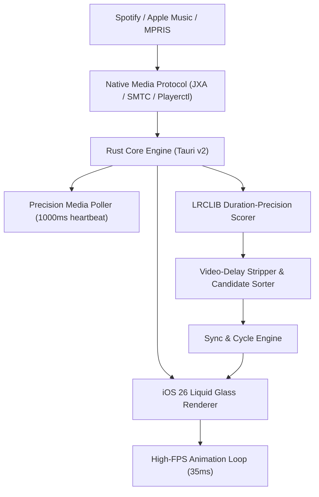

<div align="center">

  

  # LivelyLyrics

  ### Ultra-Lightweight, Floating, iOS 26 Liquid Glass Synced Lyrics Miniplayer
  **Powered by Rust + Tauri v2 & Electron Dual-Core Architecture for macOS, Windows & Linux**

  <!-- Primary Project Badges -->
  <p>
    <a href="https://github.com/malikp66/lively-lyrics/releases">
      
    </a>
    <a href="https://www.rust-lang.org/">
      
    </a>
    <a href="https://v2.tauri.app/">
      
    </a>
    <a href="https://electronjs.org/">
      
    </a>
    <a href="LICENSE">
      
    </a>
  </p>

  <!-- Live GitHub Repo Stats -->
  <p>
    <a href="https://github.com/malikp66/lively-lyrics/stargazers">
      
    </a>
    <a href="https://github.com/malikp66/lively-lyrics/network/members">
      
    </a>
    <a href="https://github.com/malikp66/lively-lyrics/releases">
      
    </a>
    <a href="https://github.com/malikp66/lively-lyrics/issues">
      
    </a>
    <a href="https://github.com/malikp66/lively-lyrics/commits/main">
      
    </a>
  </p>

  <p align="center">
    <b>LivelyLyrics</b> menghadirkan pengalaman lirik karaoke real-time yang melayang (<i>floating</i>), tembus klik (<i>click-through ghost mode</i>), dan berestetika <b>iOS 26 Liquid Glass</b> ultra-jernih untuk <b>macOS</b>, <b>Windows</b>, dan <b>Linux</b> — kini ditenagai oleh <b>Rust + Tauri v2</b> dengan konsumsi RAM ultra-rendah (< 35MB) tanpa memerlukan login ataupun Spotify API Key.
  </p>

  <p align="center">
    <a href="https://github.com/malikp66/lively-lyrics/releases/latest">
      
    </a>
    <a href="https://github.com/malikp66/lively-lyrics/releases/latest">
      
    </a>
    <a href="https://github.com/malikp66/lively-lyrics/releases/latest">
      
    </a>
    <a href="https://github.com/malikp66/lively-lyrics/releases/latest">
      
    </a>
  </p>

  <p align="center">
    <a href="#-mengapa-livelylyrics">Mengapa LivelyLyrics?</a> •
    <a href="#-fitur-unggulan">Fitur Utama</a> •
    <a href="#-mode-tampilan">Mode Tampilan</a> •
    <a href="#-shortcut-keyboard">Shortcut Keyboard</a> •
    <a href="#-kustomisasi-tampilan--teks">Kustomisasi Tampilan</a> •
    <a href="#-arsitektur-sistem--migrasi-rust">Arsitektur Rust</a> •
    <a href="#-pengembangan--build-mandiri">Pengembangan & Build</a> •
    <a href="#-faq">FAQ</a>
  </p>

</div>

---

## 💡 Mengapa LivelyLyrics?

Aplikasi desktop pemutar musik resmi seperti Spotify memiliki keterbatasan saat kita sedang *multitasking*:
1. **Tidak Ada Miniplayer Lirik Melayang**: Saat bermain game, coding di VS Code, mendesain di Figma, atau browsing, lirik lagu tidak bisa dipantau tanpa harus bolak-balik berpindah jendela.
2. **Kaku & Boros Resource**: Miniplayer berbasis browser berat dapat memakan ratusan MB RAM dan membebani GPU/CPU.
3. **Desain Monoton**: Tidak menyatu dengan estetika OS modern dan wallpaper desktop.
4. **Lirik Sering Desync**: Database lirik sering kali salah memilih versi video klip resmi YouTube (yang memiliki intro video 10-15 detik) daripada versi audio album resmi Spotify.

---

## ✨ Fitur Unggulan

| Fitur | Deskripsi |
| :--- | :--- |
| 🦀 **Rust Core Engine** | Backend berkecepatan tinggi berbasis Rust & Tauri v2; hemat daya, footprint biner ringkas, dan performa mulus tanpa beban. |
| 🍏 **Apple Liquid Glass UI** | Visual material kaca cair dengan efek specular rim light, corner radius halus khas Apple, dan typography responsif tanpa seleksi kursor yang mengganggu. |
| 🪟 **Detached Settings Window** | Jendela Pengaturan mandiri yang menempel secara presisi di dekat miniplayer tanpa melompat jauh ke tengah layar. |
| 🎤 **Only-Lyrics Subtitle 2.0** | Mode minimalis subtitle melayang dengan header 3-bagian (icon mic karaoke aktif hijau, metadata lagu draggable, dan menu opsi) yang auto-hide saat idle. |
| 🎛️ **Quick Three-Dots Menu** | Menu dropdown cepat untuk mengakses Pengaturan, Sinkronisasi Ulang, Minimize, dan Tutup jendela. |
| 🔤 **Auto-Marquee Display** | Teks judul dan nama artis yang panjang otomatis beranimasi bolak-balik halus agar selalu terbaca utuh. |
| 🎨 **4 Mode Latar Belakang** | *Liquid Glass*, *Warna Solid* (dengan tombol Randomizer warna), *Gradien Estetik* (10 preset), dan *Minimal*. |
| 🪟 **Floating Always-On-Top** | Jendela tetap berada di lapisan paling atas layar (termasuk di atas *Full-Screen Workspace* pada macOS). |
| 👻 **Ghost Mode (Click-Through)** | Aktifkan dengan shortcut `Ctrl+Alt+G` (`Cmd+Option+G` di Mac). Kursor mouse menembus jendela langsung ke aplikasi di belakangnya. |
| ⏱️ **Duration-Precision Lyrics Engine** | Memfilter dan menilai kandidat lirik LRCLIB berdasarkan kecocokan durasi lagu Spotify secara presisi serta mengeliminasi delay video klip YouTube. |
| 🔄 **Alternate Candidate Cycling** | Tekan tombol **Sync Ulang** (`Cmd+R` / `Ctrl+R`) untuk berganti antar kandidat lirik `.lrc` yang tersedia di database. |
| ⌨️ **Real-Time Offset Hotkeys** | Tekan `[` (-0.5s), `]` (+0.5s), atau `\` (Reset 0s) dengan visual pop-up **iOS Liquid Capsule Toast** secara real-time. |
| 🎯 **Interactive Seek** | Klik baris lirik mana pun atau klik timeline scrubber untuk melompati pemutaran lagu langsung ke detik tersebut. |
| 🌈 **Adaptive Ambient Glow** | Pancaran cahaya ambient lembut di belakang card yang beradaptasi secara otomatis dengan warna dominan cover art album. |
| ✍️ **Deep Typography Styling** | 5 pilihan font studio (`Plus Jakarta Sans`, `Inter`, `Outfit`, `Playfair Display`, `JetBrains Mono`), kustomisasi ukuran, ketebalan, *UPPERCASE*, *Italic*, *Neon Glow*, hingga *Crisp Outline*. |
| 📍 **Smart Window Memory** | Mengingat posisi koordinat dan ukuran jendela terakhir secara otomatis di setiap sesi. |

---

## 🖥️ Mode Tampilan Fleksibel

LivelyLyrics menyediakan mode tampilan adaptif yang dapat disesuaikan dengan kebutuhan Anda:

| Mode | Karakteristik Visual | Komponen yang Ditampilkan | Ideal Untuk |
| :--- | :--- | :--- | :--- |
| 🎴 **Card Mode**<br>*(Expanded Default)* | Jendela Apple Liquid Glass split 2-kolom dengan visual dan kontrol komprehensif | Kolom kiri: Artwork album HD, auto-marquee judul & artis, timeline scrubber interaktif dengan time preview, dock kontrol (Three Dots, Prev, Play/Pause, Next, Karaoke Mic). Kolom kanan: panggung lirik vertikal menyanyi | Multitasking santai, mendengarkan musik di desktop |
| 💬 **Only-Lyrics Mode**<br>*(Karaoke Subtitle 2.0)* | Pita lirik subtitle transparan melayang bebas halangan dengan tinggi viewport 100% | Baris lirik aktif auto-scroll di tengah layar dengan header pintar 3-bagian (mic aktif hijau, cover/judul draggable, three dots) yang otomatis auto-hide saat idle dan muncul seketika saat kursor digerakkan | Bermain game, menonton video, coding, atau membaca dokumen |

---

## ⌨️ Shortcut Keyboard

Pintasan keyboard otomatis menyesuaikan dengan platform Anda (**Windows/Linux** vs **macOS**):

| Aksi | Windows & Linux | macOS |
| :--- | :---: | :---: |
| **Toggle Mode Hanya Lirik (Subtitle)** | <kbd>Ctrl</kbd> + <kbd>Alt</kbd> + <kbd>L</kbd> | <kbd>Cmd ⌘</kbd> + <kbd>Option ⌥</kbd> + <kbd>L</kbd> |
| **Toggle Ghost Mode (Tembus Klik)** | <kbd>Ctrl</kbd> + <kbd>Alt</kbd> + <kbd>G</kbd> | <kbd>Cmd ⌘</kbd> + <kbd>Option ⌥</kbd> + <kbd>G</kbd> |
| **Force Resync / Siklus Opsi Lirik** | <kbd>Ctrl</kbd> + <kbd>R</kbd> | <kbd>Cmd ⌘</kbd> + <kbd>R</kbd> |
| **Mundurkan Lirik (-0.5 Detik)** | <kbd>[</kbd> | <kbd>[</kbd> |
| **Majukan Lirik (+0.5 Detik)** | <kbd>]</kbd> | <kbd>]</kbd> |
| **Reset Offset Lirik (0.00s)** | <kbd>\</kbd> | <kbd>\</kbd> |
| **Play / Pause Pemutaran** | <kbd>Space</kbd> | <kbd>Space</kbd> |
| **Buka / Tutup Pengaturan** | Menu Three Dots `...` / <kbd>Esc</kbd> | Menu Three Dots `...` / <kbd>Esc</kbd> |

---

## 🎨 Kustomisasi Tampilan & Teks

Buka panel **Pengaturan** melalui menu *three dots* (`...`) untuk mempersonalisasi tampilan secara *real-time*:

### 1. Gaya Material & Latar Belakang (Glassmorphism)
- **Mode Latar Belakang Jendela**:
  - *Liquid Glass*: Efek kaca cair Apple multi-layer dengan specular highlight dan refractive blur.
  - *Warna Solid*: Latar belakang solid pekat elegan dengan tombol Randomizer warna untuk menemukan palet warna baru sekali klik.
  - *Gradien Estetik*: 10 preset gradien artistik (*Aurora Glow*, *Neon Cyber*, *Deep Ocean*, *Sunset Velvet*, *Cosmic Purple*, *Nordic Night*, dll).
  - *Minimal*: Transparansi ultra-tipis hemat daya dan distraction-free.
- **Transparansi Jendela**: Slider `15%` hingga `100%`.
- **Intensitas Blur Kaca**: Slider `0px` hingga `45px`.

### 2. Tipografi & Gaya Lirik
- **Tema Aksen & Ambient**: 6 preset warna (*Spotify Green*, *Velvet Purple*, *Cyber Cyan*, *Sunset Amber*, *Rose*, *Frost*) + *Custom Accent Color Picker*.
- **Warna Teks Lirik Aktif**: *Putih Bersih*, *Mengikuti Warna Aksen*, *Gold Champagne*, *Ice Cyan*, atau warna kustom.
- **Warna Teks Non-Aktif**: Preset kontras (*Default*, *Cool Slate*, *Warm*, *Mint*) atau warna kustom.
- **Koleksi Font Studio**: `Plus Jakarta Sans`, `Inter`, `Outfit`, `Playfair Display` (Serif elegan), dan `JetBrains Mono` (Coding look).
- **Format & Dekorasi**: `Normal`, `Italic`, `UPPERCASE`, atau `Capitalize`.
- **Efek Pendar (Glow) & Garis Tepi (Outline)**: *Neon Glow* (Lembut / Kuat) serta opsi *Drop Shadow* atau *Crisp Outline* agar teks tetap terbaca sangat kontras di atas wallpaper terang atau layar game.

---

## 🏗️ Arsitektur Sistem & Migrasi Rust

LivelyLyrics mengusung arsitektur **Tauri v2 + Rust Native Core** dengan kompatibilitas **Dual-Core (Electron Fallback)**:



### Keunggulan Rust Backend:
1. **Low Memory Footprint**: Hanya menggunakan ~30-35MB RAM dibandingkan ~120-180MB pada arsitektur Electron murni.
2. **Instant Window Dragging**: Memanfaatkan native OS event handling untuk pergeseran jendela yang mulus tanpa stutter.
3. **Smart Candidate Matching**: Algoritma cerdas yang membedakan rekaman audio studio dari klip musik YouTube berdasarkan delta durasi milidetik dan filter metadata.

---

## 🛠️ Pengembangan & Build Mandiri

Bagi developer yang ingin menjalankan atau mengompilasi LivelyLyrics sendiri dari *source code*:

### Prasyarat
- [Node.js](https://nodejs.org/) v18+ & npm
- [Rust](https://www.rust-lang.org/tools/install) v1.80+ (`cargo`)

### 1. Mode Development (Tauri v2 - Rekomendasi)
```bash
git clone https://github.com/malikp66/lively-lyrics.git
cd lively-lyrics
npm install

# Menjalankan mode development Tauri v2 (Rust + Hot Reload)
npm run tauri:dev
```

### 2. Mode Development (Electron Fallback)
```bash
npm start
```

### 3. Menjalankan Unit Test Rust
```bash
cd src-tauri
cargo test
```
*Termasuk unit test untuk validasi sinkronisasi audio album vs YouTube video klip.*

### 4. Mem-build Paket Installer Rilis (Tauri v2)
Hasil build installer native akan otomatis tersimpan di folder `src-tauri/target/release/bundle/`:
```bash
npm run tauri:build
```

### 5. Mem-build Paket Installer (Electron)
```bash
npm run dist:mac    # macOS (.dmg & .zip)
npm run dist:win    # Windows (.exe installer NSIS & portable)
npm run dist:linux  # Linux (.AppImage & .deb)
```

---

## ❓ FAQ (Frequently Asked Questions)

<details>
<summary><b>Apakah saya perlu Spotify Premium atau Spotify API Key?</b></summary>
<br>
<b>Sama sekali tidak!</b> LivelyLyrics beroperasi langsung melalui protokol sesi media sistem operasi (macOS JXA Automation, Windows SMTC, atau Linux MPRIS2). Akun Spotify Free maupun Premium dapat menggunakannya tanpa perlu login akun atau membuat aplikasi pengembang di Spotify Developer Dashboard.
</details>

<details>
<summary><b>Mengapa lirik lagu tertentu sempat terlambat beberapa detik, dan bagaimana solusinya?</b></summary>
<br>
Hal ini biasanya terjadi jika lirik diunggah dari video klip YouTube (yang memiliki intro dialog/helikopter 10-15 detik) alih-alih audio album resmi. LivelyLyrics v3.2.0 kini memiliki <b>Duration-Precision Scoring</b> yang otomatis memilih versi audio studio bersih. Jika masih ada selisih, cukup tekan tombol <b>Sync Ulang (Cmd+R / Ctrl+R)</b> untuk berganti ke kandidat lirik berikutnya, atau gunakan hotkey <code>[</code> dan <code>]</code> untuk fine-tune offset.
</details>

<details>
<summary><b>Bagaimana cara keluar dari Ghost Mode saat jendela tidak dapat diklik?</b></summary>
<br>
Cukup tekan kombinasi keyboard shortcut <b><code>Cmd + Option + G</code></b> (macOS) atau <b><code>Ctrl + Alt + G</code></b> (Windows/Linux).
</details>

<details>
<summary><b>Bagaimana cara mengaktifkan izin di macOS jika dicegat System Settings?</b></summary>
<br>
Buka <b>System Settings &rarr; Privacy & Security</b>, scroll ke bawah ke bagian Security, lalu klik <b>Open Anyway</b>. Pada dialog Automation, klik <b>Allow / OK</b> agar aplikasi diizinkan membaca judul lagu dan posisi detik dari Spotify / Apple Music.
</details>

---

## 📜 Lisensi

Proyek ini dilisensikan di bawah lisensi **[MIT License](LICENSE)**. Bebas digunakan, dimodifikasi, dan didistribusikan untuk keperluan personal maupun komersial.

<div align="center">
  <p>Dibuat dengan ❤️ untuk para penikmat musik, estetika desktop, dan multitasking di macOS, Windows, dan Linux.</p>
</div>
