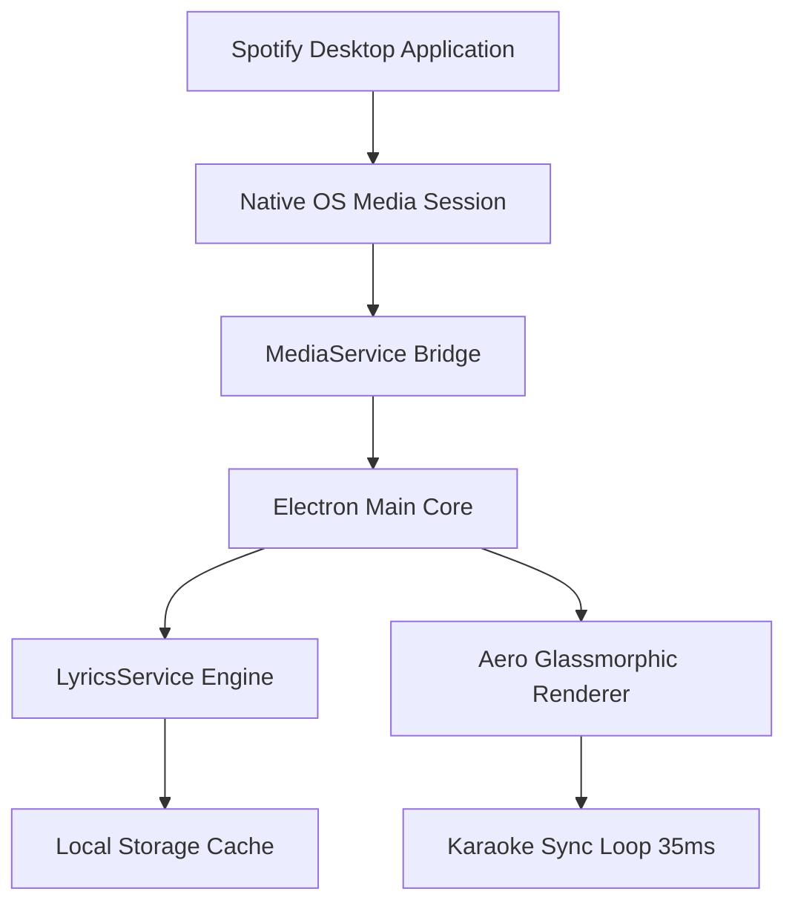

<div align="center">

  

  # LivelyLyrics

  ### Modern, Floating, Glassmorphic Spotify Lyrics Miniplayer for Windows

  <!-- Primary Project Badges -->
  <p>
    <a href="https://github.com/malikp66/lively-lyrics/releases">
      
    </a>
    <a href="https://github.com/malikp66/lively-lyrics">
      
    </a>
    <a href="https://electronjs.org/">
      
    </a>
    <a href="LICENSE">
      
    </a>
  </p>

  <!-- Live GitHub Repo Stats -->
  <p>
    <a href="https://github.com/malikp66/lively-lyrics/stargazers">
      
    </a>
    <a href="https://github.com/malikp66/lively-lyrics/network/members">
      
    </a>
    <a href="https://github.com/malikp66/lively-lyrics/releases">
      
    </a>
    <a href="https://github.com/malikp66/lively-lyrics/issues">
      
    </a>
    <a href="https://github.com/malikp66/lively-lyrics/commits/master">
      
    </a>
  </p>

  <p align="center">
    <b>LivelyLyrics</b> menghadirkan pengalaman lirik Spotify karaoke real-time yang melayang (floating), tembus klik (click-through ghost mode), dan transparan dengan estetika <i>Aero Glassmorphism</i> modern tanpa memerlukan login ataupun Spotify API Key.
  </p>

  <p align="center">
    <a href="#-fitur-unggulan">Fitur Utama</a> •
    <a href="#-download--instalasi">Instalasi</a> •
    <a href="#-mode-tampilan">Mode Tampilan</a> •
    <a href="#-shortcut-keyboard">Shortcut</a> •
    <a href="#-kustomisasi-tampilan">Kustomisasi</a> •
    <a href="#-arsitektur-sistem">Arsitektur</a> •
    <a href="#-star-history">Star History</a> •
    <a href="#-faq">FAQ</a>
  </p>

</div>

---

## 💡 Mengapa LivelyLyrics?

Aplikasi desktop Spotify resmi memiliki keterbatasan besar:
1. **Tidak Ada Miniplayer Lirik Melayang**: Saat bermain game, coding di VS Code, atau browsing, lirik lagu tidak bisa dipantau tanpa harus bolak-balik alt-tab ke jendela Spotify.
2. **Tidak Transparan**: Tidak bisa disesuaikan dengan tema desktop atau wallpaper hidup.
3. **Menghalangi Kursor**: Jendela floating konvensional menghalangi klik mouse saat beraktivitas.

**LivelyLyrics memecahkan semua masalah tersebut:**
- 🪟 **Always-on-Top & Ghost Mode**: Melayang di atas game/aplikasi, dan kursor mouse bisa tembus (*click-through*).
- ⚡ **Zero Setup & Instant Sync**: Terhubung langsung ke Windows Media Transport Control (SMTC) secara native. Putar lagu di Spotify, dan lirik langsung tampil sinkron.
- 🎨 **Deep Aesthetics**: Efek Frosted Glass, Ambient Glow dinamis, pilihan font studio, custom accent color, dan berbagai mode ukuran.

---

## ✨ Fitur Unggulan

| Fitur | Deskripsi |
| :--- | :--- |
| 🪟 **Floating Always-On-Top** | Jendela tetap berada di lapisan paling atas layar tanpa tertekan oleh jendela aplikasi lain. |
| 👻 **Ghost Mode (Click-Through)** | Aktifkan dengan shortcut `Ctrl+Alt+G`. Kursor mouse akan menembus jendela LivelyLyrics langsung ke aplikasi di baliknya. |
| ⏱️ **Ultra-Precise Synced Lyrics** | Sinkronisasi per milidetik (35ms loop engine) dengan lirik karaoke aktif yang bersinar dan auto-center scrolling. |
| 🎯 **Interactive Seek** | Klik bait lirik mana pun di layar untuk langsung melompati pemutaran Spotify ke detik bait tersebut. |
| 💬 **Only-Lyrics (Subtitle Mode)** | Sembunyikan cover art dan tombol navigasi; ubah miniplayer menjadi pita subtitle lirik minimalis di pojok layar. |
| 🌈 **Aero Glass & Ambient Glow** | Efek kaca akrilik semi-transparan dengan backdrop cahaya ambient yang beradaptasi dengan status pemutaran. |
| 🎚️ **Customizable Typography** | Pilihan 5 jenis font (Plus Jakarta Sans, Inter, Outfit, Playfair, JetBrains Mono), slider ukuran font, ketebalan, dan efek neon glow. |
| 🛠️ **Latency Compensation** | Slider offset waktu (+/- 0.5s atau +/- 0.1s) untuk mengoreksi jeda audio Bluetooth atau headphone nirkabel. |
| 🔄 **Auto-Updates In-App** | Sistem auto-update bawaan yang langsung memeriksa dan mengunduh pembaruan versi terbaru. |
| 🛡️ **CrashGuard Resilience** | Penanganan error defensif; aplikasi tidak akan force-close meskipun koneksi internet terputus atau metadata kosong. |

---

## 🖥️ Mode Tampilan Fleksibel

LivelyLyrics menyediakan **3 mode tampilan adaptif** yang dirancang untuk berbagai kebutuhan multitasking:

| Mode | Karakteristik Visual | Komponen yang Ditampilkan | Ideal Untuk |
| :--- | :--- | :--- | :--- |
| 🎴 **Card Mode**<br>*(Expanded Default)* | Jendela aero-glass elegan dengan visual dan kontrol lengkap | Artwork album, equalizer bars, timeline scrubber, kontrol pemutar, dan 3–5 baris lirik mengalir | Multitasking santai, mendengarkan musik di layar desktop |
| 💊 **Compact Mode**<br>*(Dynamic Island)* | Bar horizontal ultra-ramping satu baris hemat tempat | Mini artwork cover, judul trek, dan 1 baris lirik aktif yang ringkas | Diletakkan tepat di atas/bawah Taskbar saat bekerja atau coding |
| 💬 **Only-Lyrics Mode**<br>*(Pure Subtitle)* | Tanpa frame, tanpa cover art, murni floating text transparan | 2 baris lirik mengambang dengan floating toolbar interaktif saat kursor mendekat | Bermain game layar penuh, menonton video, atau membaca dokumen |

> [!TIP]
> Anda dapat beralih mode kapan saja dengan cepat menggunakan shortcut keyboard:
> - **Mode Hanya Lirik (Subtitle)**: <kbd>Ctrl</kbd> + <kbd>Alt</kbd> + <kbd>L</kbd>
> - **Ghost Mode (Tembus Klik)**: <kbd>Ctrl</kbd> + <kbd>Alt</kbd> + <kbd>G</kbd>


---

## 🚀 Panduan Instalasi & Penggunaan (Cross-Platform)

LivelyLyrics mendukung penuh sistem operasi **Windows**, **macOS**, dan **Linux**.

### 🪟 1. Windows (10 / 11)

**Metode 1: Installer `.exe` (Paling Mudah)**
1. Unduh installer resmi terbaru: 👉 **[`LivelyLyrics-Setup-2.2.3.exe`](https://github.com/malikp66/lively-lyrics/releases)**
2. Jalankan file `.exe` dan ikuti wizard instalasi NSIS (bisa pilih buat shortcut di Desktop / Start Menu).
3. Buka **LivelyLyrics**, jalankan **Spotify**, dan putar lagu apapun. Lirik langsung sinkron otomatis via *Windows System Media Transport Controls (SMTC)*.

**Metode 2: Dari Source Code**
```bash
git clone https://github.com/malikp66/lively-lyrics.git
cd livelylyrics
npm install
npm start
# Untuk build installer Windows:
npm run dist:win
```

---

### 🍎 2. macOS (Intel & Apple Silicon M1/M2/M3)

LivelyLyrics di macOS menggunakan jembatan *AppleScript / JXA* native yang sangat ringan tanpa perlu menginstal dependensi tambahan.

**Cara Menjalankan & Menggunakan:**
1. Clone repositori dan install dependensi:
   ```bash
   git clone https://github.com/malikp66/lively-lyrics.git
   cd livelylyrics
   npm install
   npm start
   ```
2. **Persetujuan Izin (Penting)**:
   Saat pertama kali dijalankan, macOS akan menampilkan dialog privasi:
   > *"LivelyLyrics wants access to control Spotify"*.
   Pilih **Allow / OK** agar LivelyLyrics diizinkan membaca status lagu dan lirik dari Spotify.
3. **Membuat Paket Installer `.dmg` / `.app`**:
   ```bash
   npm run dist:mac
   ```
   File `.dmg` siap dipasang dengan menyeret ikon LivelyLyrics ke folder `Applications`.

---

### 🐧 3. Linux (Ubuntu, Debian, Fedora, Arch, dll.)

LivelyLyrics di Linux berkomunikasi melalui antarmuka standar *MPRIS2 D-Bus* menggunakan `playerctl`.

**Prasyarat (Pasang `playerctl`):**
```bash
# Ubuntu / Debian / Linux Mint:
sudo apt install playerctl

# Fedora / RHEL:
sudo dnf install playerctl

# Arch Linux / Manjaro:
sudo pacman -S playerctl
```

**Cara Menjalankan & Menggunakan:**
1. Clone repositori dan jalankan aplikasi:
   ```bash
   git clone https://github.com/malikp66/lively-lyrics.git
   cd livelylyrics
   npm install
   npm start
   ```
2. Buka Spotify (Desktop / Flatpak / Snap). LivelyLyrics akan mendeteksi sesi lagu Spotify secara instan.
3. **Membuat Paket `.AppImage` atau `.deb`**:
   ```bash
   npm run dist:linux
   ```
   Hasil build `.AppImage` dan `.deb` akan tersedia di dalam folder `dist/`.

---

## ⌨️ Shortcut Keyboard

Akses kontrol cepat kapan saja tanpa harus membuka panel setting:

| Shortcut | Aksi |
| :---: | :--- |
| **`Ctrl + Alt + G`** | **Toggle Ghost Mode** (Mode tembus klik kursor mouse) |
| **`Ctrl + Alt + L`** | **Toggle Mode Hanya Lirik** (Subtitle / Pure Lyrics Mode) |
| **`Ctrl + R`** | **Force Resync** (Sinkronkan ulang status & lirik secara instan) |
| **`Esc`** | Menutup modal jendela Pengaturan jika sedang terbuka |
| **`Space`** | Play / Pause lagu (saat jendela miniplayer aktif) |

---

## 🎨 Kustomisasi Tampilan

Buka menu Pengaturan melalui ikon gerigi (`⚙️`) di header untuk menyesuaikan setiap detail estetika:

### 1. Gaya Background
- **Frosted Glass (Default)**: Efek kaca es aero modern dengan pantulan specular.
- **Obsidian Dark**: Latar belakang hitam pekat bergradasi untuk kontras maksimal di layar OLED.
- **Minimal Outline**: Tanpa warna pekat, hanya garis border kaca tipis transparan.
- **Custom Tint**: Tentukan warna dasar dan transparansi Anda sendiri via *color picker*.

### 2. Aksen Warna
Tersedia 6 preset warna tema atau pilih warna HEX bebas:
- 🟢 **Spotify Green** (`#1ed760`)
- 🟣 **Neon Violet** (`#a855f7`)
- 🔵 **Cyber Cyan** (`#06b6d4`)
- 🟠 **Sunset Amber** (`#f59e0b`)
- 🔴 **Rose Quartz** (`#f43f5e`)
- ❄️ **Frostbite Blue** (`#38bdf8`)

### 3. Tipografi & Ukuran
- **Font Family**: Plus Jakarta Sans, Inter, Outfit, Playfair Display (Serif), atau JetBrains Mono.
- **Ukuran Lirik**: Small, Medium, Large, Extra Large, hingga Jumbo.
- **Glow Effect**: Subtle, Soft Neon, hingga Vibrant.
- **Inactive Line Opacity**: Atur tingkat redup lirik sebelum dan sesudah bait aktif (15% - 85%).

---

## 🏗️ Arsitektur Sistem

LivelyLyrics dirancang dengan arsitektur modular non-blocking untuk menghasilkan performa tinggi, latensi sinkronisasi minimal (< 35ms), dan penggunaan CPU hemat (< 0.5%):

| Lapisan (Layer) | Komponen | Fungsi & Mekanisme Kerja |
| :--- | :--- | :--- |
| 🎵 **Media Provider** | Spotify Desktop | Memutar audio dan menyiarkan sesi pemutaran ke API Media OS. |
| ⚡ **OS Session Hook** | Windows SMTC / macOS AppleScript / Linux MPRIS2 | Membaca metadata lagu dan posisi playback secara langsung tanpa OAuth token Spotify. |
| ⚙️ **Core Service** | Electron Main (`main.js` & `mediaService.js`) | Mengelola lifecycle jendela aplikasi, IPC bridge, dan koordinasi pencarian lirik. |
| 📜 **Lyrics Engine** | LRCLIB API + Local Cache | Mengambil bait lirik `.lrc` tersinkronisasi dan menyimpannya di cache lokal untuk akses instan. |
| 🎨 **Glass Renderer** | Chromium WebContents (`app.js` & CSS Glass) | Merender antarmuka kaca aero, pendaran ambient cover art, dan auto-scroll lirik pada 60+ FPS. |



### Keunggulan Arsitektur:
- **Zero Token Expiration**: Tidak bergantung pada OAuth token Spotify yang sering kedaluwarsa.
- **Off-Thread Processing**: Komunikasi Windows SMTC dijalankan di proses terpisah, menjaga antarmuka tetap berjalan pada 60+ FPS mulus.
- **Multi-Level Cache**: Lirik yang pernah dimuat disimpan secara lokal untuk akses instan tanpa kuota ganda.

---

## ❓ FAQ (Frequently Asked Questions)

<details>
<summary><b>Apakah saya perlu Spotify Premium untuk menggunakan LivelyLyrics?</b></summary>
<br>
<b>Tidak!</b> LivelyLyrics membaca status pemutaran langsung dari Windows Media Session (SMTC). Akun Spotify Free maupun Spotify Premium dapat menggunakannya tanpa kendala.
</details>

<details>
<summary><b>Bagaimana jika lagu tidak memiliki lirik otomatis?</b></summary>
<br>
Anda dapat menekan tombol <b>Cari Ulang Lirik</b> atau gunakan tombol pencarian manual di tab <b>Lirik</b> pada menu Pengaturan untuk memasukkan judul lagu dan artis secara manual.
</details>

<details>
<summary><b>Bagaimana cara keluar dari Ghost Mode jika mouse tidak bisa klik?</b></summary>
<br>
Cukup tekan kombinasi keyboard <b><code>Ctrl + Alt + G</code></b> kapan saja. Status tembus klik akan langsung dinonaktifkan dan jendela dapat diklik kembali.
</details>

<details>
<summary><b>Apakah LivelyLyrics membebani performa saat bermain game?</b></summary>
<br>
Sangat ringan. LivelyLyrics memanfaatkan akselerasi hardware Chromium yang hemat daya, dan background PowerShell daemon hanya menggunakan CPU &lt; 0.5% pada pemutaran aktif.
</details>

---

## 📈 Star History

Jika Anda menyukai proyek ini, silakan tinggalkan bintang ⭐ di GitHub untuk mendukung perkembangan **LivelyLyrics**!

<div align="center">
  <a href="https://star-history.com/#malikp66/lively-lyrics&Date">
    <picture>
      <source media="(prefers-color-scheme: dark)" srcset="https://api.star-history.com/svg?repos=malikp66/lively-lyrics&type=Date&theme=dark" />
      <source media="(prefers-color-scheme: light)" srcset="https://api.star-history.com/svg?repos=malikp66/lively-lyrics&type=Date" />
      
    </picture>
  </a>
</div>

<br>

<div align="center">
  <h3>✨ Suka dengan LivelyLyrics?</h3>
  <p>Berikan dukungan Anda dengan memberikan Star (⭐) pada repositori ini!</p>
  <a href="https://github.com/malikp66/lively-lyrics">
    
  </a>
</div>

---

## 👥 Kontributor

Terima kasih banyak kepada semua kontributor yang turut serta menyempurnakan LivelyLyrics:

<p align="center">
  <a href="https://github.com/malikp66/lively-lyrics/graphs/contributors">
    
  </a>
</p>

---

## 🤝 Berkontribusi

Kontribusi, *bug report*, dan *feature request* selalu disambut hangat!
1. Fork repositori ini
2. Buat branch fitur baru (`git checkout -b feature/FiturKeren`)
3. Commit perubahan Anda (`git commit -m 'Menambahkan FiturKeren'`)
4. Push ke branch Anda (`git push origin feature/FiturKeren`)
5. Buat **Pull Request**

---

## 📜 Lisensi

Proyek ini dilisensikan di bawah lisensi **[MIT License](LICENSE)**. Bebas digunakan, dimodifikasi, dan didistribusikan untuk keperluan personal maupun komersial.

<div align="center">
  <p>Dibuat dengan ❤️ untuk para pecinta musik dan multitasking di Windows.</p>
</div>
