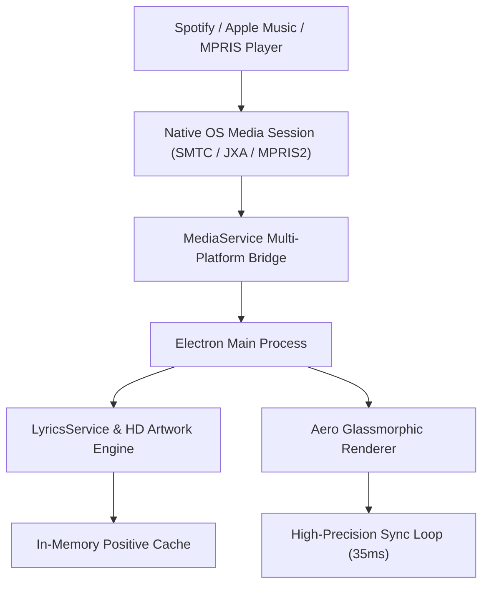

<div align="center">

  

  # LivelyLyrics

  ### Modern, Floating, Glassmorphic Synced Lyrics Miniplayer for Windows, macOS & Linux

  <!-- Primary Project Badges -->
  <p>
    <a href="https://github.com/malikp66/lively-lyrics/releases">
      
    </a>
    <a href="https://github.com/malikp66/lively-lyrics/releases">
      
    </a>
    <a href="https://electronjs.org/">
      
    </a>
    <a href="LICENSE">
      
    </a>
  </p>

  <!-- Live GitHub Repo Stats -->
  <p>
    <a href="https://github.com/malikp66/lively-lyrics/stargazers">
      
    </a>
    <a href="https://github.com/malikp66/lively-lyrics/network/members">
      
    </a>
    <a href="https://github.com/malikp66/lively-lyrics/releases">
      
    </a>
    <a href="https://github.com/malikp66/lively-lyrics/issues">
      
    </a>
    <a href="https://github.com/malikp66/lively-lyrics/commits/main">
      
    </a>
  </p>

  <p align="center">
    <b>LivelyLyrics</b> menghadirkan pengalaman lirik karaoke real-time yang melayang (<i>floating</i>), tembus klik (<i>click-through ghost mode</i>), dan transparan dengan estetika <i>Aero Glassmorphism</i> modern untuk <b>Windows</b>, <b>macOS</b>, dan <b>Linux</b> — tanpa memerlukan login ataupun Spotify API Key.
  </p>

  <p align="center">
    <a href="https://github.com/malikp66/lively-lyrics/releases/latest/download/LivelyLyrics-Setup-2.2.3.exe">
      
    </a>
    <a href="https://github.com/malikp66/lively-lyrics/releases/latest/download/LivelyLyrics-2.2.3-arm64.dmg">
      
    </a>
    <a href="https://github.com/malikp66/lively-lyrics/releases/latest/download/LivelyLyrics-2.2.3.dmg">
      
    </a>
    <a href="https://github.com/malikp66/lively-lyrics/releases/latest/download/LivelyLyrics-2.2.3.AppImage">
      
    </a>
    <a href="https://github.com/malikp66/lively-lyrics/releases/latest/download/livelylyrics-miniplayer_2.2.3_amd64.deb">
      
    </a>
  </p>

  <p align="center">
    <a href="#-download--instalasi-rilis">Download & Instalasi</a> •
    <a href="#-fitur-unggulan">Fitur Utama</a> •
    <a href="#-mode-tampilan">Mode Tampilan</a> •
    <a href="#-shortcut-keyboard">Shortcut</a> •
    <a href="#-kustomisasi-tampilan--teks">Kustomisasi Teks & UI</a> •
    <a href="#-pengembangan--build-mandiri">Pengembangan & Build</a> •
    <a href="#-arsitektur-sistem">Arsitektur</a> •
    <a href="#-faq">FAQ</a>
  </p>

</div>

---

## 💡 Mengapa LivelyLyrics?

Aplikasi desktop pemutar musik seperti Spotify memiliki keterbatasan saat kita sedang *multitasking*:
1. **Tidak Ada Miniplayer Lirik Melayang**: Saat bermain game, coding di VS Code, mendesain, atau browsing, lirik lagu tidak bisa dipantau tanpa harus bolak-balik berpindah jendela.
2. **Tidak Transparan**: Tidak bisa menyatu secara estetis dengan tema desktop atau wallpaper.
3. **Menghalangi Kursor**: Jendela floating biasa menghalangi klik mouse saat kita sedang bekerja.

**LivelyLyrics memecahkan semua masalah tersebut di 3 sistem operasi utama:**
- 🪟 **Always-on-Top & Ghost Mode**: Melayang di atas game/aplikasi (termasuk *Full-Screen Workspace* di macOS), dan kursor mouse bisa tembus (*click-through*).
- ⚡ **Zero Setup & Native OS Hook**: Terhubung langsung ke **Windows SMTC**, **macOS JXA (Spotify & Apple Music)**, serta **Linux MPRIS2 (`playerctl`)**. Putar lagu, dan lirik langsung tampil sinkron.
- 🎨 **Full Text & Glass Customization**: Atur gaya kaca (Frosted, Obsidian, Minimal, Custom Tint), warna teks lirik aktif & non-aktif, pilihan 5 font studio, dekorasi teks (*Italic*, *UPPERCASE*, *Capitalize*), serta garis tepi teks (*Drop Shadow* / *Crisp Outline*).

---

## 📦 Download & Instalasi Rilis

Klik tombol download langsung sesuai perangkat Anda:

| Perangkat / OS | Tombol Download Langsung | Tipe & Arsitektur | Panduan Cepat |
| :--- | :--- | :--- | :--- |
| 🪟 **Windows 10 / 11** | [**⬇️ Unduh Installer (.exe)**](https://github.com/malikp66/lively-lyrics/releases/latest/download/LivelyLyrics-Setup-2.2.3.exe)<br>[*Versi Portable (.exe)*](https://github.com/malikp66/lively-lyrics/releases/latest/download/LivelyLyrics-2.2.3.exe) | Installer NSIS resmi `x64` | [Panduan Windows](#-1-windows) |
| 🍎 **macOS (Apple Silicon)** | [**⬇️ Unduh .dmg (M1/M2/M3/M4)**](https://github.com/malikp66/lively-lyrics/releases/latest/download/LivelyLyrics-2.2.3-arm64.dmg)<br>[*Versi .zip*](https://github.com/malikp66/lively-lyrics/releases/latest/download/LivelyLyrics-2.2.3-arm64-mac.zip) | Apple Silicon (`arm64`) | [Panduan macOS](#-2-macos) |
| 🍏 **macOS (Intel)** | [**⬇️ Unduh .dmg (Intel Mac)**](https://github.com/malikp66/lively-lyrics/releases/latest/download/LivelyLyrics-2.2.3.dmg)<br>[*Versi .zip*](https://github.com/malikp66/lively-lyrics/releases/latest/download/LivelyLyrics-2.2.3-mac.zip) | Mac Prosesor Intel (`x64`) | [Panduan macOS](#-2-macos) |
| 🐧 **Linux (Universal)** | [**⬇️ Unduh .AppImage**](https://github.com/malikp66/lively-lyrics/releases/latest/download/LivelyLyrics-2.2.3.AppImage) | Universal Portable `x86_64` | [Panduan Linux](#-3-linux) |
| 🐧 **Linux (Ubuntu/Debian)** | [**⬇️ Unduh Paket .deb**](https://github.com/malikp66/lively-lyrics/releases/latest/download/livelylyrics-miniplayer_2.2.3_amd64.deb) | Native Debian / Ubuntu (`amd64`) | [Panduan Linux](#-3-linux) |

> [!IMPORTANT]
> **🛡️ Catatan Keamanan Saat Membuka Pertama Kali (Aplikasi Open-Source):**
> * 🪟 **Windows**: Jika muncul layar biru *SmartScreen*, klik **More info** $\rightarrow$ **Run anyway**.
> * 🍎 **macOS**: Jika dicegat dialog *Apple could not verify*, buka **System Settings** $\rightarrow$ **Privacy & Security** $\rightarrow$ klik **Open Anyway** (atau jalankan perintah `xattr -cr /Applications/LivelyLyrics.app` di Terminal). Klik **Allow / OK** saat pop-up izin kontrol Spotify/Music muncul.
> * 🐧 **Linux**: Wajib pasang `playerctl` (`sudo apt install playerctl`). Berikan izin eksekusi (`chmod +x LivelyLyrics-*.AppImage`) atau pasang `.deb` via `sudo apt install ./livelylyrics-*.deb`.

---

### 🪟 1. Windows
1. Jalankan [**`LivelyLyrics-Setup-2.2.3.exe`**](https://github.com/malikp66/lively-lyrics/releases/latest/download/LivelyLyrics-Setup-2.2.3.exe) (atau [versi Portable](https://github.com/malikp66/lively-lyrics/releases/latest/download/LivelyLyrics-2.2.3.exe)).
2. Ikuti instruksi wizard hingga selesai.
3. Putar musik di **Spotify Desktop**, lirik akan otomatis sinkron via Windows SMTC.

---

### 🍎 2. macOS
1. Buka file `.dmg` ([Apple Silicon](https://github.com/malikp66/lively-lyrics/releases/latest/download/LivelyLyrics-2.2.3-arm64.dmg) / [Intel](https://github.com/malikp66/lively-lyrics/releases/latest/download/LivelyLyrics-2.2.3.dmg)), lalu seret ikon **LivelyLyrics** ke folder **Applications**.
2. Buka aplikasi. Jika muncul peringatan keamanan, buka **System Settings** $\rightarrow$ **Privacy & Security** $\rightarrow$ klik **Open Anyway**.
3. Klik **Allow / OK** saat diminta izin kontrol Spotify / Apple Music.

---

### 🐧 3. Linux
1. Pasang dependensi media:
   ```bash
   sudo apt install playerctl   # Ubuntu/Debian/Mint
   # sudo dnf install playerctl # Fedora
   # sudo pacman -S playerctl   # Arch Linux
   ```
2. Jalankan aplikasi:
   * **AppImage**: `chmod +x LivelyLyrics-*.AppImage && ./LivelyLyrics-*.AppImage`
   * **Paket .deb**: `sudo apt install ./livelylyrics-miniplayer_*_amd64.deb`

---

## ✨ Fitur Unggulan

| Fitur | Deskripsi |
| :--- | :--- |
| 🪟 **Floating Always-On-Top** | Jendela tetap berada di lapisan paling atas layar (termasuk di atas *Full-Screen Workspace* pada macOS). |
| 👻 **Ghost Mode (Click-Through)** | Aktifkan dengan shortcut `Ctrl+Alt+G` (`Cmd+Option+G` di Mac). Kursor mouse menembus jendela langsung ke aplikasi di belakangnya. |
| ⏱️ **Ultra-Precise Synced Lyrics** | Sinkronisasi per milidetik (35ms loop engine) dengan lirik karaoke aktif yang bersinar dan *smooth center scrolling* di semua mode. |
| 🎯 **Interactive Seek** | Klik bait lirik mana pun atau klik timeline bar untuk langsung melompati pemutaran lagu ke detik tersebut. |
| 💬 **Only-Lyrics (Subtitle Mode)** | Sembunyikan cover art dan tombol navigasi; ubah miniplayer menjadi pita subtitle lirik murni yang tetap berjalan mulus mengikuti lagu. |
| 🌈 **Aero Glass & Ambient Glow** | Efek kaca akrilik semi-transparan dengan backdrop cahaya ambient yang beradaptasi secara dinamis dengan cover art album. |
| ✍️ **Advanced Text & Color Styling** | Atur warna teks lirik aktif, warna lirik non-aktif, ukuran font, ketebalan, gaya huruf (*Italic*, *UPPERCASE*, *Capitalize*), efek *Neon Glow*, hingga *Crisp Outline / Drop Shadow*. |
| 🛠️ **Latency Compensation** | Tombol offset waktu (`-0.5s`, `-0.1s`, `+0.1s`, `+0.5s`) untuk mengoreksi jeda audio speaker Bluetooth atau TWS. |
| 📍 **Smart Window Memory** | Menyimpan posisi koordinat layar terakhir secara otomatis sehingga jendela selalu terbuka di posisi favorit Anda. |
| 🔄 **Auto-Updates In-App** | Sistem auto-update bawaan via GitHub Releases untuk memeriksa dan mengunduh pembaruan versi terbaru. |

---

## 🖥️ Mode Tampilan Fleksibel

LivelyLyrics menyediakan **3 mode tampilan adaptif** yang dapat diganti kapan saja:

| Mode | Karakteristik Visual | Komponen yang Ditampilkan | Ideal Untuk |
| :--- | :--- | :--- | :--- |
| 🎴 **Card Mode**<br>*(Expanded Default)* | Jendela aero-glass elegan dengan visual dan kontrol lengkap | Artwork album, live equalizer, timeline scrubber dengan preview waktu, kontrol pemutar, dan aliran lirik penuh | Multitasking santai, mendengarkan musik di layar desktop |
| 💊 **Compact Mode**<br>*(Dynamic Island)* | Bar horizontal ramping hemat tempat | Mini artwork cover, judul trek, scrubber, dan lirik ringkas | Diletakkan di sudut layar saat bekerja atau coding |
| 💬 **Only-Lyrics Mode**<br>*(Pure Subtitle)* | Tanpa cover art, tanpa dock kontrol, murni floating subtitle transparan dengan auto-scroll | Baris lirik aktif & sekitarnya yang mengalir otomatis + toolbar melayang saat kursor diarahkan ke atas | Bermain game, menonton video, atau membaca dokumen |

---

## ⌨️ Shortcut Keyboard

Pintasan keyboard otomatis menyesuaikan dengan sistem operasi Anda (**Windows/Linux** vs **macOS**):

| Aksi | Windows & Linux | macOS |
| :--- | :---: | :---: |
| **Toggle Mode Hanya Lirik (Subtitle)** | <kbd>Ctrl</kbd> + <kbd>Alt</kbd> + <kbd>L</kbd> | <kbd>Cmd ⌘</kbd> + <kbd>Option ⌥</kbd> + <kbd>L</kbd> |
| **Toggle Ghost Mode (Tembus Klik)** | <kbd>Ctrl</kbd> + <kbd>Alt</kbd> + <kbd>G</kbd> | <kbd>Cmd ⌘</kbd> + <kbd>Option ⌥</kbd> + <kbd>G</kbd> |
| **Force Resync Lirik & Waktu** | <kbd>Ctrl</kbd> + <kbd>R</kbd> | <kbd>Cmd ⌘</kbd> + <kbd>R</kbd> |
| **Play / Pause Lagu** | <kbd>Space</kbd> | <kbd>Space</kbd> |
| **Tutup Jendela Pengaturan** | <kbd>Esc</kbd> | <kbd>Esc</kbd> |

---

## 🎨 Kustomisasi Tampilan & Teks

Buka menu Pengaturan melalui ikon slider (`⚙️`) di bagian atas untuk mengatur seluruh tampilan secara *real-time*:

### 1. Kustomisasi Background (Latar Belakang)
- **Gaya Kaca**: *Frosted Glass*, *Obsidian Dark*, *Minimal*, atau *Custom Tint* (pilih warna HEX bebas).
- **Transparansi Jendela**: Slider `15%` hingga `100%` (otomatis menjadi solid saat jendela Pengaturan dibuka agar teks pengaturan selalu jelas dibaca).
- **Intensitas Blur Kaca**: Slider `0px` hingga `45px`.

### 2. Kustomisasi Warna & Styling Teks Lirik
- **Tema Aksen & Glow**: 6 preset warna (*Spotify Green*, *Velvet Purple*, *Cyber Cyan*, *Sunset Amber*, *Rose*, *Frost*) + *Custom Accent Color Picker*.
- **Warna Teks Lirik Aktif**: Pilih *Putih*, *Ikuti Warna Aksen*, *Gold*, *Ice Cyan*, atau pilih warna bebas melalui *Custom Text Color Picker*.
- **Warna Teks Lirik Non-Aktif**: Pilih preset (*Default*, *Cool Slate*, *Warm*, *Mint*) atau pilih warna bebas.
- **Gaya Font Huruf**: `Plus Jakarta Sans`, `Inter`, `Outfit`, `Playfair Display` (Serif), dan `JetBrains Mono`.
- **Ukuran & Ketebalan**: 5 tingkat ukuran (*Kecil* s/d *Jumbo*) dan 4 tingkat ketebalan (`400` s/d `800`).
- **Gaya & Dekorasi Teks**: `Normal`, `Italic`, `UPPERCASE`, atau `Capitalize`.
- **Efek Pendar (Glow) & Garis Tepi (Outline)**: Atur intensitas *Neon Glow* serta aktifkan *Drop Shadow* atau *Crisp Outline* agar lirik tetap terbaca tajam di atas latar belakang terang atau game.

---

## 🛠️ Pengembangan & Build Mandiri

Bagi Anda yang ingin berkontribusi atau menjalankan LivelyLyrics langsung dari *source code*:

### 1. Menjalankan Mode Development
```bash
git clone https://github.com/malikp66/lively-lyrics.git
cd lively-lyrics
npm install
npm start
```

### 2. Mem-build Paket Installer Sendiri
Hasil kompilasi biner akan dihasilkan di folder `dist/`:

```bash
# Build biner sesuai OS yang sedang aktif
npm run dist

# Build spesifik per platform
npm run dist:win    # Windows (.exe installer NSIS & portable)
npm run dist:mac    # macOS (.dmg & .zip)
npm run dist:linux  # Linux (.AppImage & .deb)
```

---

## 🏗️ Arsitektur Sistem

LivelyLyrics dirancang dengan arsitektur modular *non-blocking* untuk menghasilkan latensi sinkronisasi minimal (< 35ms) dan konsumsi CPU yang sangat hemat:

| Lapisan (Layer) | Komponen | Fungsi & Mekanisme Kerja |
| :--- | :--- | :--- |
| 🎵 **Media Provider** | Spotify / Apple Music / MPRIS Player | Memutar audio dan menyiarkan sesi pemutaran ke sistem operasi. |
| ⚡ **OS Session Bridge** | • **Windows**: PowerShell GSMTC Daemon<br>• **macOS**: Native JXA (`osascript`)<br>• **Linux**: `playerctl` MPRIS2 D-Bus | Membaca metadata lagu, cover art, dan posisi waktu secara langsung tanpa OAuth token Spotify. |
| ⚙️ **Core Service** | Electron Main (`main.js` & `mediaService.js`) | Mengelola *window lifecycle*, penyimpanan posisi jendela, shortcut global, dan Tray menu. |
| 📜 **Lyrics Engine** | LRCLIB API + iTunes HD Artwork + Cache | Mencari lirik `.lrc` tersinkronisasi dengan algoritma pencocokan durasi terdekat. |
| 🎨 **Glass Renderer** | Chromium WebContents (`app.js` & `style.css`) | Merender antarmuka kaca aero, pendaran ambient cover art, dan auto-scroll lirik pada ~30–60 FPS. |



---

## ❓ FAQ (Frequently Asked Questions)

<details>
<summary><b>Apakah saya perlu Spotify Premium untuk menggunakan LivelyLyrics?</b></summary>
<br>
<b>Tidak!</b> LivelyLyrics membaca status pemutaran langsung dari sesi media sistem operasi (Windows SMTC, macOS Automation, atau Linux MPRIS2). Akun Spotify Free maupun Premium dapat menggunakannya tanpa kendala.
</details>

<details>
<summary><b>Bagaimana jika lagu remix/cover tidak memiliki lirik otomatis?</b></summary>
<br>
Anda dapat menekan tombol <b>Sync Ulang (Ctrl+R / Cmd+R)</b> atau membuka menu <b>Pengaturan &rarr; Sinkronisasi &rarr; Cari Lirik Manual</b> untuk mengetikkan judul lagu/artis secara spesifik.
</details>

<details>
<summary><b>Bagaimana cara keluar dari Ghost Mode jika jendela tidak bisa diklik?</b></summary>
<br>
Tekan pintasan keyboard <b><code>Ctrl + Alt + G</code></b> (Windows/Linux) atau <b><code>Cmd + Option + G</code></b> (macOS), atau klik kanan ikon LivelyLyrics di System Tray / Menu Bar lalu pilih <b>Toggle Ghost Mode</b>.
</details>

---

## 📜 Lisensi

Proyek ini dilisensikan di bawah lisensi **[MIT License](LICENSE)**. Bebas digunakan, dimodifikasi, dan didistribusikan untuk keperluan personal maupun komersial.

<div align="center">
  <p>Dibuat dengan ❤️ untuk para pecinta musik dan multitasking di Windows, macOS, dan Linux.</p>
</div>
